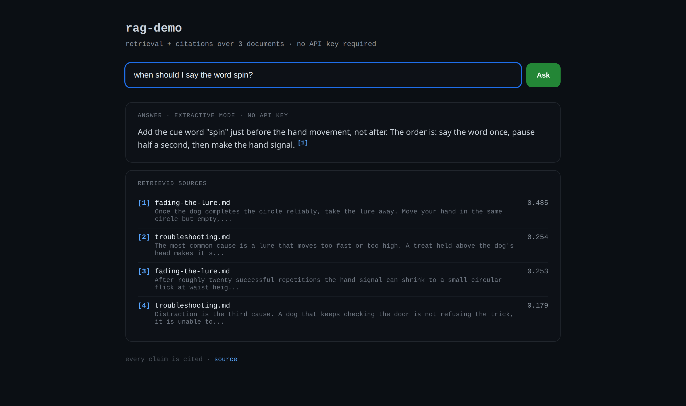

# rag-demo

A retrieval-augmented answering pipeline in one dependency-free Python file, built to show
the parts that decide whether a RAG system is trustworthy: **chunking, retrieval, a
relevance floor that refuses to answer, and citations on every claim.**

The sample corpus is deliberately mundane — three short documents about teaching a dog to
spin — because the point is the pipeline, not the domain. Point it at your own documents with
`python3 rag.py ingest <folder>`.



```bash
python3 rag.py serve                        # web UI on http://127.0.0.1:8010
python3 rag.py ingest docs/                 # chunk + embed + index
python3 rag.py ask "how are duplicate webhooks avoided?"   # same pipeline, terminal
python3 rag.py eval                         # hit@1 / hit@4 against a golden set
```

No install step, no model download, no API key. `index.json` is generated.

## What it demonstrates

| Concern | Where |
|---|---|
| Paragraph-aware chunking with overlap | `chunks()` |
| Embeddings with a swappable backend | `local_vec()` / `openai_embed()`, `RAG_EMBEDDER=openai` |
| Cosine retrieval + relevance floor | `retrieve()`, `answer()` |
| Grounded answering with `[n]` citations | `PROMPT`, `answer()` |
| Retrieval quality measured, not assumed | `evaluate()` + `questions.json` |
| Web UI with clickable citations, zero frontend build | `serve()`, `render()` |

## Sample run

```
$ python3 rag.py eval
PASS hit@1: how long should each training session be
PASS hit@2: what do I do if the dog refuses to turn
PASS hit@1: when should I add the word spin
PASS hit@3: how do I stop using the treat as a lure
PASS hit@2: how often should I reward the dog later on
PASS hit@1: should I physically push the dog to turn

hit@1 3/6  hit@4 6/6
```

`hit@4 6/6` is the number that matters for a RAG pipeline: the correct chunk always reaches
the prompt. `hit@1 3/6` is where the local hashing embedder hits its ceiling on paraphrase —
the production system put a cross-encoder reranker in exactly that gap.

## Design decisions

- **Local embeddings by default.** Hashing + IDF vectors are weak but deterministic and free,
  so `eval` is reproducible on any machine and CI needs no secrets. Set `RAG_EMBEDDER=openai`
  to swap in `text-embedding-3-small` without touching the pipeline.
- **Refusing beats guessing.** If the top chunk scores below the floor, `ask` says so instead
  of answering from whatever scored highest. In an audit-heavy domain a wrong answer costs
  more than no answer.
- **Answering is optional.** Without `OPENAI_API_KEY`, `ask` returns the winning chunk
  labelled "extractive" rather than pretending a model wrote it.
- **Eval is part of the CLI.** A RAG change that cannot be measured is a guess.

## Limits (on purpose, documented rather than hidden)

- The local embedder has no semantic understanding: it matches vocabulary, so paraphrases miss.
- No reranker here; the production version added a cross-encoder and paid ~180 ms per query.
- Single-file on purpose — this is a readable reference, not a framework.

## Production notes

The system this demo distils ran on PostgreSQL + pgvector with BullMQ workers: webhooks
persisted before acknowledgement, idempotency keyed on `tenant_id + message_id`, constant-time
dedupe in Redis, audit log on every state change, and a dead-letter queue with owner alerts.
Those pieces live in private client repositories; this repository is a clean-room
reimplementation of the retrieval path using only its own sample documents.
